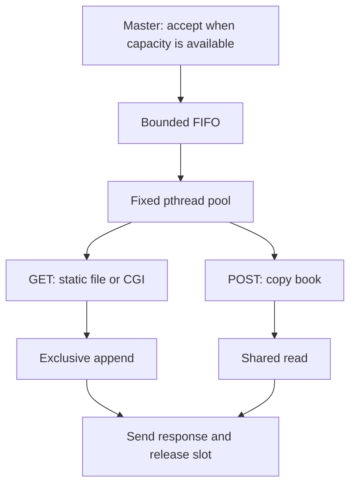

# Multithreaded Web Server

A C11 HTTP server with a fixed POSIX thread pool, bounded admission and a writer-priority request log. It grew out of Technion Operating Systems HW3. Its central design question is where to block: an idle worker waits for a connection, a full server leaves new connections in the kernel backlog, and a slow client sends or receives data outside the shared log lock.

## Request lifecycle



Each successful GET appends its statistics to the book. POST returns a consistent snapshot. Several POST requests can copy concurrently. A queued GET prevents new readers from entering until the writers finish. Capacity counts both queued and active connections, including workers still sending responses. See [architecture](docs/architecture.md) for the predicates, ownership transitions and shutdown sequence.

## Build and try it

Linux with glibc 2.34+ or modern macOS, a C11 compiler and Make. For tests and benchmarks, install Python 3.9+.

```sh
make -j2
./server 8080 4 8 0
```

The arguments are port, worker count, maximum admitted connections and logger delay in seconds. A positive delay applies to reads and writes inside the logical critical section. Zero or a negative value disables the delay. Run in the repository directory so the server can find `public/`. In a second terminal:

```sh
curl -i http://127.0.0.1:8080/
curl -i 'http://127.0.0.1:8080/output.cgi?0.025'
curl -i -X POST http://127.0.0.1:8080/
make test
```

Ctrl-C stops admission and drains the workers. Each request uses a fresh connection. The following fields were captured from a static GET on a fresh Linux instance. The assignment specifies the literal double-colon spelling. The second colon is part of the HTTP field value.

```text
Stat-Req-Arrival:: 1795098832.991126
Stat-Req-Dispatch:: 1795098832.991218
Stat-Log-Arrival:: 1795098832.992546
Stat-Log-Dispatch:: 1795098832.992605
Stat-Thread-Id:: 1
Stat-Thread-Count:: 1
Stat-Thread-Static:: 1
Stat-Thread-Dynamic:: 0
Stat-Thread-Post:: 0
```

## Implementation history

| Origin | Scope |
| --- | --- |
| Course starter | Single-threaded server scaffold, request parsing and serving routines, statistics format, dummy logger, socket and robust-I/O helpers, client, demo CGI, assets and Makefile. |
| Recovered student implementation | Fixed pool, FIFO and active-request accounting in `server.c`; writer-priority monitor and book storage in `log.c`; per-worker counters and GET/POST integration in `request.c`; client changes. Identified by comparing the extracted sources with the recovered starter ZIP. This comparison establishes project-level contributions and cannot distinguish individual coauthors. |
| Subsequent portfolio work | Audited and hardened with Codex assistance. Changes include admission before accept, bounded HTTP parsing, timestamp consistency, POST debug timing, isolated CGI descriptors, graceful shutdown, Linux tests, sanitizer checks and a reproducible load driver. |

The first commit preserves the recovered source snapshot with normalized text line endings. The assignment PDF, submission archives and identifying submission data are excluded. The course-provided materials have no redistribution license in the recovered archive. Keep this repository private pending permission.

## Verification

The optimized build passed on ARM64 Linux with GCC 13.3. The monitor test and all seven integration tests passed. Two further full integration runs passed. The Linux suite passed with AddressSanitizer and UndefinedBehaviorSanitizer together (leak detection enabled), and with ThreadSanitizer in a separate build. Apple Clang 21 also built the native macOS targets with warnings treated as errors. The [test guide](docs/testing.md) gives commands, assertions and timeouts. The [Linux workflow](.github/workflows/linux.yml) defines hosted validation.

## Measured performance

Eight concurrent loopback clients, 80 measured GETs per trial, three trials per configuration. Each cell is a median across trials. Hardware was an Apple M2 MacBook Pro with 8 GB RAM. Measurements ran inside a two-vCPU, 1.5 GiB ARM64 Ubuntu 24.04.5 guest using QEMU 10.1.2 software emulation, Linux 7.0.12-linuxkit, GCC 13.3 and `-O2 -g`. Reproduce with `make clean && make -j2 && make bench`.

| GET workload | Workers | Capacity | Requests/s | p50 ms | p95 ms |
| --- | ---: | ---: | ---: | ---: | ---: |
| Static home page | 1 | 8 | 246.37 | 28.93 | 46.72 |
| Static home page | 4 | 1 | 256.50 | 28.55 | 44.22 |
| Static home page | 4 | 4 | 245.95 | 29.18 | 47.46 |
| Static home page | 4 | 8 | 252.56 | 27.98 | 46.73 |
| CGI with 25 ms delay | 1 | 8 | 27.08 | 284.48 | 370.58 |
| CGI with 25 ms delay | 4 | 1 | 27.51 | 288.03 | 292.53 |
| CGI with 25 ms delay | 4 | 4 | 114.89 | 63.55 | 75.68 |
| CGI with 25 ms delay | 4 | 8 | 118.62 | 61.71 | 72.07 |

At capacity one, four workers delivered nearly the same delayed-CGI throughput as one worker. Raising capacity to four let multiple children sleep concurrently. Increasing workers had little effect on the static workload at capacity eight. The one-worker run uses the same master/worker architecture. The original single-thread starter lacks equivalent log and statistics work.

## Tradeoffs

- POST copies the complete in-memory book under shared ownership. Its cost grows with history; several readers can each hold a full snapshot. The book has no retention policy or persistence.
- Writer priority can indefinitely delay readers under sustained writes. FIFO admission also allows slow clients and slow CGI to occupy scarce workers.
- The document tree and CGI executables are trusted deployment inputs. CGI output is spooled to a temporary file; arbitrary CGI has no resource quota or execution deadline. Keep the document root immutable while serving.
- The protocol covers the course's one-request connections, static GET, CGI GET and log-reading POST. The server binds to IPv4 interfaces and has no TLS, authentication, keep-alive or general HTTP application routing.
